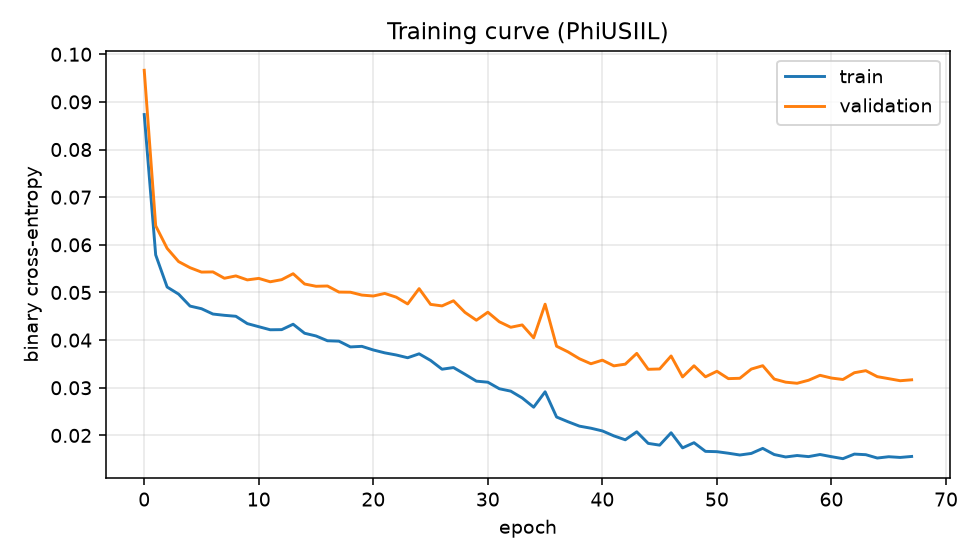
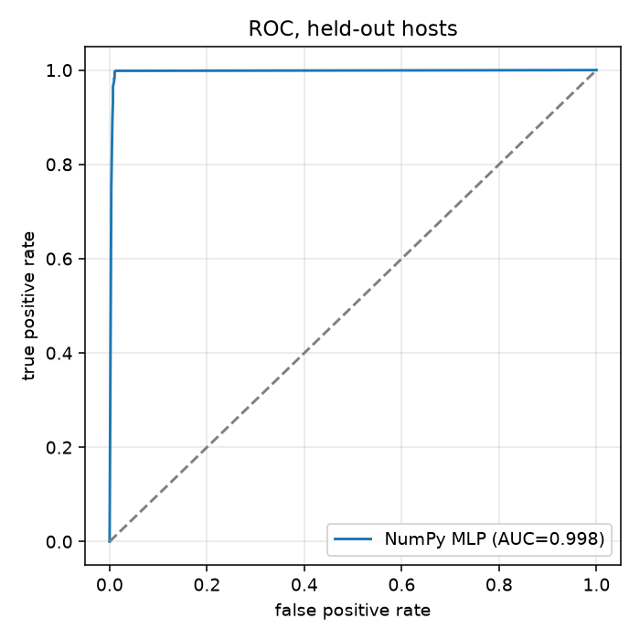

# URLSentinel training report

Trained on **data.csv**: 15,071 real URLs (9,062 phishing). Test set = 2,156 URLs from **hostnames never seen in training**.

| model | accuracy | precision | recall | F1 | ROC-AUC | train (s) |
|---|---|---|---|---|---|---|
| NumPyMLP | 0.9935 | 0.9923 | 0.9969 | 0.9946 | 0.9975 | 3.7 |
| LogisticRegression | 0.9791 | 0.9676 | 0.9984 | 0.9828 | 0.9904 | 0.1 |
| RandomForest | 0.9958 | 0.9946 | 0.9984 | 0.9965 | 0.9990 | 0.29 |

Data audit flagged possible shortcuts (starts with https://, has www.), which is why the [live test](#-live-test-on-todays-phishing) below matters more than these numbers.

## Data audit

| check | phishing | legitimate |
|---|---|---|
| starts with https:// | 100.0% | 37.2% | ⚠️
| has www. | 100.0% | 55.8% | ⚠️
| has a path beyond '/' | 0.0% | 20.4% |
| has a query string | 0.0% | 4.9% |

## NumPy MLP confusion matrix

| | predicted legit | predicted phishing |
|---|---|---|
| **actual legit** | 860 | 10 |
| **actual phishing** | 4 | 1,282 |

